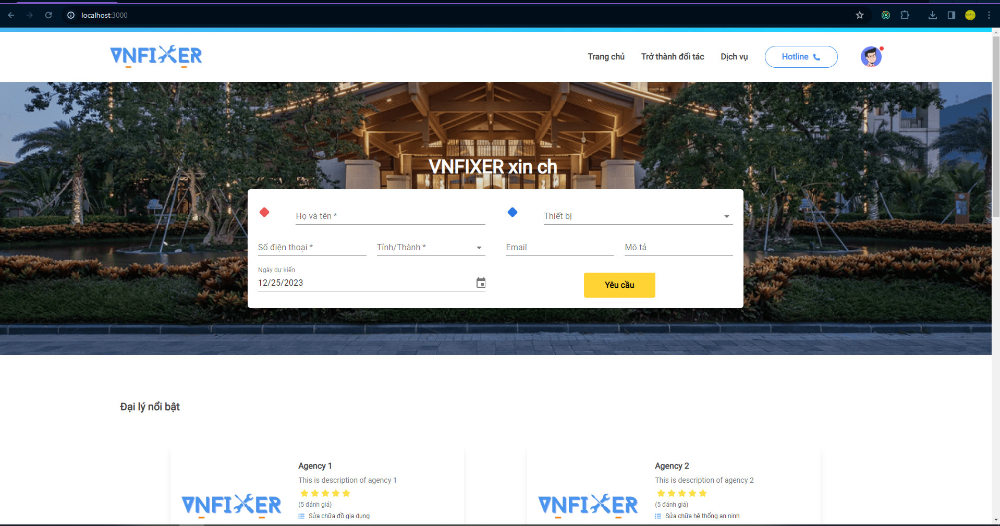
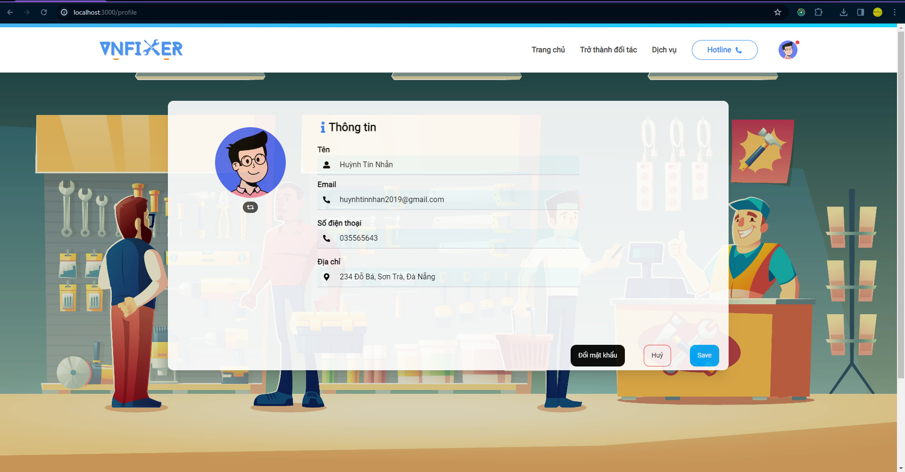
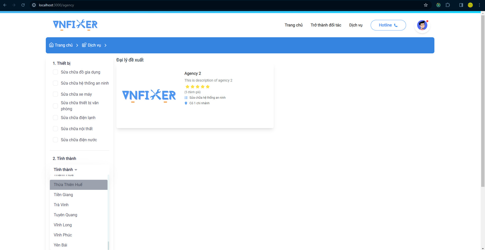
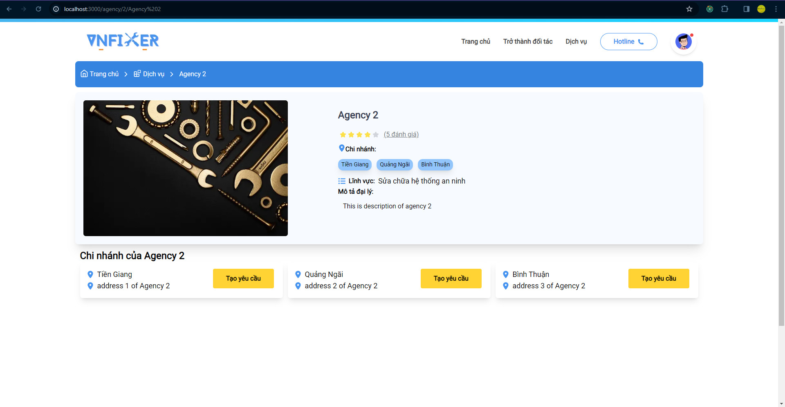
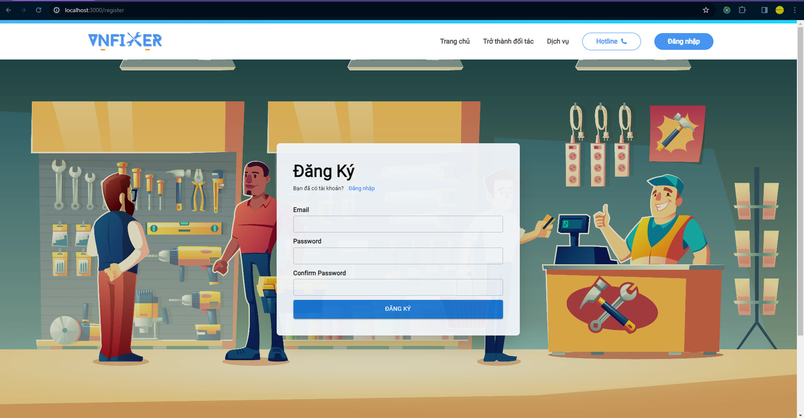
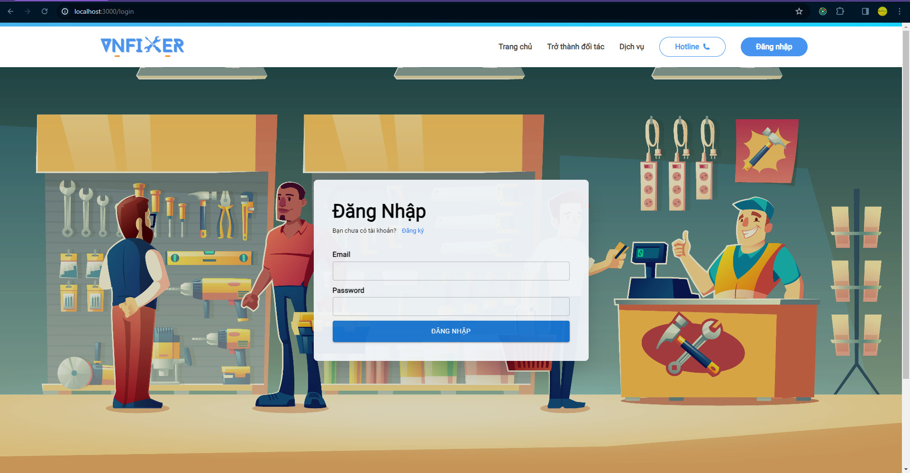

## Available Scripts for VNFIXER website

In the project directory, you can run:

### `npm install`

then run

### `npm run dev`

Runs the app in the development mode.\
Open [http://localhost:3000](http://localhost:3000) to view it in your browser.

## Preview

# Home page

# Profile page

# Agency page

# Detail agency page

# Register page

# Login page

## Demo

# `...updating`
